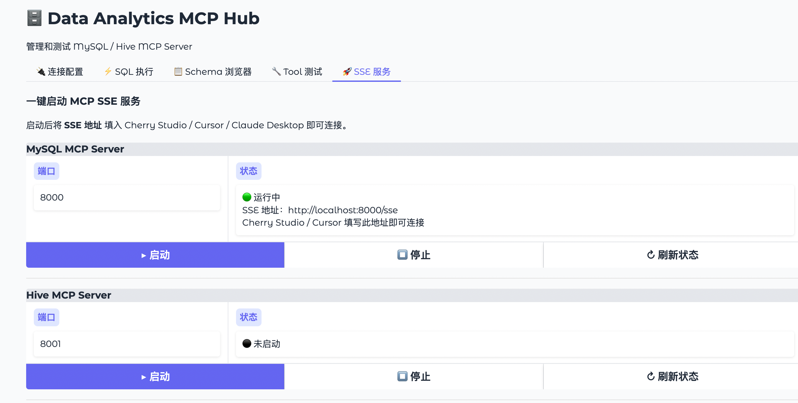

# Data Analytics MCP Hub


**通过 MCP 客户端用自然语言查询 MySQL 和 Hive 数仓。**

> [English](README.md)。数据库和 MCP 服务可部署在内网，但查询结果可能经客户端发送给外部模型服务。数据是否出网取决于客户端、模型供应商和部署配置，不保证默认完全本地处理。

---

## 能做什么

在 Claude Desktop / Cherry Studio / Cursor 里直接问：

> "查一下 orders 表最近 7 天的订单量，按天汇总"
> "users 表的结构是什么？"
> "帮我找出销售额 Top10 的产品"

Claude 会自动调用 MCP Server 查询你的数据库，返回结果。**你不需要写一行 SQL。**

---

## 两种接入方式

| 方式 | 适用场景 | 优点 |
|------|----------|------|
| **stdio**（标准输入输出） | Claude Desktop | 零端口占用，直接进程通信 |
| **SSE**（Server-Sent Events） | Cherry Studio、Cursor、任意支持 HTTP 的客户端 | 一个服务多客户端复用，支持远程访问 |

---

## 快速开始（MySQL 用户）

### 前置要求

- Python 3.9 或以上 → [下载地址](https://www.python.org/downloads/)
- 一个可以连接的 MySQL 数据库
- （可选）[Claude Desktop](https://claude.ai/download) 用于自然语言查询

### 第一步：下载项目

```bash
git clone https://github.com/albertyuee/MCP_Hub.git
cd MCP_Hub
```

### 第二步：一键启动

**macOS / Linux：**
```bash
bash start.sh
```

脚本会自动：
1. 检测依赖并安装
2. 首次运行时创建 `.env` 配置文件
3. 启动 Web 管理界面

**Windows：**
```bash
pip install -r requirements-mysql.txt
copy .env.example .env
# 用记事本打开 .env，填写数据库信息
python web/app.py
```

### 第三步：填写数据库连接信息

用文本编辑器打开 `.env` 文件，填写以下内容：

```env
MYSQL_HOST=localhost        # 数据库地址
MYSQL_PORT=3306             # 端口，默认 3306
MYSQL_USER=root             # 用户名
MYSQL_PASSWORD=your_password
MYSQL_DATABASE=your_database
```

### 第四步：打开 Web 界面

浏览器访问 **http://localhost:7860**，在「连接配置」Tab 中点击「测试 MySQL 连接」，显示 ✅ 即成功。

---

## 接入方式一：SSE（推荐用于 Cherry Studio / Cursor）

SSE 模式会启动一个 HTTP 服务，任何支持 SSE 传输的 MCP 客户端都可以通过 URL 直接连接，**无需在每个客户端里配置 Python 路径**。

### 方法 A：通过 Web 界面启动 SSE 服务

1. 浏览器打开 **http://localhost:7860**
2. 切换到「🚀 SSE 服务」Tab
3. 选择数据库类型（MySQL / Hive），确认端口
4. 点击「▶ 启动」，状态变为「运行中」即成功

默认端口：MySQL → `8000`，Hive → `8001`

### 方法 B：命令行手动启动

```bash
# MySQL SSE 服务（监听 8000 端口）
python servers/mysql_mcp/server.py --transport sse --port 8000

# Hive SSE 服务（监听 8001 端口）
python servers/hive_mcp/server.py --transport sse --port 8001
```

### 在 Cherry Studio 中接入

1. 打开 Cherry Studio → 设置 → MCP 服务器
2. 点击「添加服务器」
3. 类型选择 **SSE**
4. 填写 URL：

```
http://localhost:8000/sse      ← MySQL
http://localhost:8001/sse      ← Hive
```

5. 保存后刷新，工具列表出现 `execute_query` 等即成功。

### 在 Cursor 中接入

1. 打开 Cursor → Settings → Features → MCP
2. 点击「Add new MCP server」
3. 类型选择 **SSE**，填写 URL：

```
http://localhost:8000/sse
```

4. 保存，重启 Cursor 即可在 Composer（Agent 模式）中使用。

### 在 Claude Desktop 中通过 SSE 接入

编辑配置文件：
- macOS：`~/Library/Application Support/Claude/claude_desktop_config.json`
- Windows：`%APPDATA%\Claude\claude_desktop_config.json`

```json
{
  "mcpServers": {
    "mysql-mcp-sse": {
      "transport": "sse",
      "url": "http://localhost:8000/sse"
    }
  }
}
```

> **注意**：使用 SSE 方式前，需先在 Web 界面或命令行启动 SSE 服务。

---

## 接入方式二：stdio（推荐用于 Claude Desktop）

stdio 模式下，客户端直接启动 MCP Server 进程通信，**不需要提前启动任何服务**，Claude Desktop 会在需要时自动拉起进程。

### 在 Claude Desktop 中接入

**1. 找到配置文件**

- macOS：`~/Library/Application Support/Claude/claude_desktop_config.json`
- Windows：`%APPDATA%\Claude\claude_desktop_config.json`

**2. 添加以下配置（修改路径和数据库信息）**

```json
{
  "mcpServers": {
    "mysql-mcp": {
      "command": "python3",
      "args": ["/你的项目路径/servers/mysql_mcp/server.py"],
      "env": {
        "MYSQL_HOST": "localhost",
        "MYSQL_PORT": "3306",
        "MYSQL_USER": "root",
        "MYSQL_PASSWORD": "your_password",
        "MYSQL_DATABASE": "your_database"
      }
    }
  }
}
```

**3. 重启 Claude Desktop**，对话框左下角出现 🔌 图标即成功。

> 参考示例：`examples/claude_desktop_config.json`

---

## 接入 Hive（需要额外步骤）

Hive 依赖需要系统级库，安装前先执行：

**macOS：**
```bash
brew install cyrus-sasl
pip install -r requirements-hive.txt
```

**Ubuntu / CentOS：**
```bash
sudo apt-get install libsasl2-dev   # Ubuntu
sudo yum install cyrus-sasl-devel   # CentOS
pip install -r requirements-hive.txt
```

**Windows：** 暂不推荐，Hive 依赖在 Windows 上安装较复杂。

然后在 `.env` 中填写 Hive 连接信息：

```env
HIVE_HOST=localhost
HIVE_PORT=10000
HIVE_USERNAME=hive
HIVE_PASSWORD=
HIVE_DATABASE=default
HIVE_AUTH=NONE     # NONE | CUSTOM | KERBEROS
```

**启动方式（二选一）：**

```bash
# stdio 模式
python servers/hive_mcp/server.py

# SSE 模式
python servers/hive_mcp/server.py --transport sse --port 8001
```

---

## 功能一览

| 工具 | 支持数据库 | 说明 |
|------|-----------|------|
| **execute_query** | MySQL / Hive | 执行 SELECT 查询，返回 JSON 结果，自动缓存 |
| **get_schema** | MySQL / Hive | 获取表结构（字段名、类型、注释） |
| **list_tables** | MySQL / Hive | 列出数据库所有表 |
| **explain_query** | MySQL / Hive | 查看 SQL 执行计划 |
| **get_partitions** | Hive 专属 | 获取 Hive 分区列表，防止全表扫描 |

**内置安全保障：**
- 自动拦截 DROP / DELETE / UPDATE / ALTER 等危险操作
- 查询结果自动限制行数（默认 1000 行），防止返回海量数据
- 查询结果 TTL 缓存（MySQL 5 分钟，Hive 10 分钟），重复查询秒级响应
- 查询超时保护（MySQL 30 秒，Hive 60 秒）

---

## Web 管理界面功能

访问 **http://localhost:7860** 可使用以下功能：

| Tab | 功能 |
|-----|------|
| 🔌 连接配置 | 测试 MySQL / Hive 连接是否正常 |
| ⚡ SQL 执行 | 直接执行 SQL 并查看结果 |
| 📋 Schema 浏览 | 浏览数据库表结构，支持模糊筛选 |
| 🔧 工具测试 | 模拟 MCP 工具调用，验证输出格式 |
| 🚀 SSE 服务 | 一键启动 / 停止 SSE 服务，查看连接地址 |

---

## 常见问题

**Q：连接提示 "Access denied"**
A：检查 `.env` 中的用户名和密码是否正确，确认该用户有 SELECT 权限。

**Q：macOS 安装 sasl 失败**
A：先运行 `brew install cyrus-sasl`，再重新 `pip install -r requirements-hive.txt`。

**Q：Web 界面打开是空白**
A：等待几秒刷新，Gradio 首次加载需要时间。

**Q：Claude Desktop 没有出现 🔌 图标**
A：检查配置文件路径是否正确，JSON 格式是否合法，重启 Claude Desktop。

**Q：SSE 服务启动后客户端连不上**
A：确认端口未被占用（`lsof -i :8000`），检查防火墙设置；本机访问用 `127.0.0.1`，跨机器访问需将 `MCP_SERVER_HOST` 改为 `0.0.0.0`。

**Q：Cherry Studio / Cursor 找不到工具**
A：确认 SSE 服务已启动（Web 界面 SSE Tab 显示「运行中」），URL 末尾需包含 `/sse`。

---

## 项目结构

```
MCPhub/
├── shared/              # 公共模块（SQL 安全 / 缓存 / Schema 抽取）
├── servers/
│   ├── mysql_mcp/       # MySQL MCP Server（支持 stdio & SSE）
│   └── hive_mcp/        # Hive MCP Server（支持 stdio & SSE）
├── web/app.py           # Web 管理界面（含 SSE 服务管理）
├── examples/            # 示例代码（Claude Desktop 配置、LangChain 集成）
├── start.sh             # 一键启动脚本
├── .env.example         # 配置模板
├── requirements.txt         # 基础依赖
├── requirements-mysql.txt   # MySQL 依赖
└── requirements-hive.txt    # Hive 依赖（含 MySQL）
```

---

## License

MIT
